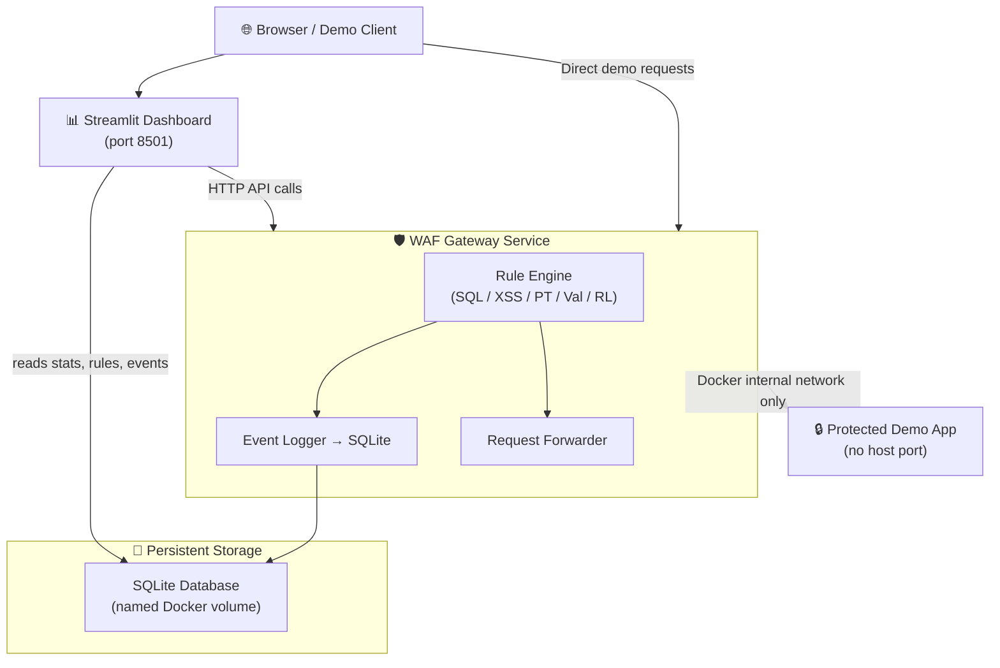

# 🛡️ SentinelShield: Web Application Firewall & Attack Simulation Platform

> **A Dockerized educational security gateway for detecting, blocking, logging, and analyzing common web application attacks.**

---

## Table of Contents

1. [Problem Statement](#1-problem-statement)
2. [Project Objectives](#2-project-objectives)
3. [Threat Model](#3-threat-model)
4. [System Architecture](#4-system-architecture)
5. [Technology Stack](#5-technology-stack)
6. [Component Descriptions](#6-component-descriptions)
7. [Request Inspection Workflow](#7-request-inspection-workflow)
8. [Detection Rules](#8-detection-rules)
9. [Database Schema](#9-database-schema)
10. [API Reference](#10-api-reference)
11. [Docker Architecture](#11-docker-architecture)
12. [Installation](#12-installation)
13. [Startup & Shutdown](#13-startup--shutdown)
14. [Running Tests](#14-running-tests)
15. [Troubleshooting](#15-troubleshooting)
16. [Security Limitations](#16-security-limitations)
17. [Future Enhancements](#17-future-enhancements)
18. [Optional AWS Deployment](#18-optional-aws-deployment)
19. [Screencast Script](#19-screencast-script)
20. [Presentation Slides Outline](#20-presentation-slides-outline)

---

## 1. Problem Statement

Web applications face constant threats from SQL injection, cross-site scripting, path traversal, and volumetric abuse. Understanding how these attacks work — and how they are detected — is a core competency in information assurance. This project builds a functional educational security gateway that demonstrates attack detection in real time, without requiring expensive commercial tools or cloud subscriptions.

---

## 2. Project Objectives

- Inspect HTTP requests before they reach a protected application.
- Detect SQL injection, XSS, path traversal, and anomalous inputs.
- Block malicious requests; forward legitimate ones.
- Log all security decisions to a persistent SQLite database.
- Provide a live dashboard with real statistics and analytics.
- Allow rule enabling/disabling for demonstration purposes.
- Run entirely on a local machine with Docker Compose.
- Prove behavior with automated unit and integration tests.

---

## 3. Threat Model

| Threat | Description | Mitigation |
|--------|-------------|------------|
| SQL Injection | Attacker injects SQL syntax to manipulate database queries | Pattern detection (SQL-001–004), parameterized queries in protected app |
| Cross-Site Scripting | Attacker injects scripts executed by other users' browsers | Pattern detection (XSS-001–003), HTML escaping in protected app |
| Path Traversal | Attacker accesses files outside intended directories | Pattern detection (PT-001), input normalization |
| Request Flooding | Attacker overwhelms the application with requests | Rate limiting (RL-001) |
| Oversized Payloads | Attacker sends large bodies to cause resource exhaustion | Body-size validation (VAL-002) |
| HTTP Method Abuse | Attacker uses unexpected methods (TRACE, CONNECT) | Method allowlist (VAL-003) |

**Not in scope:** Authentication bypass, business logic flaws, deserialization attacks, server-side request forgery.

---

## 4. System Architecture



---

## 5. Technology Stack

| Component | Technology | Version |
|-----------|-----------|---------|
| Gateway | Python / Flask | 3.11 / 3.0.3 |
| WSGI Server | Gunicorn | 22.0.0 |
| Protected App | Python / Flask | 3.11 / 3.0.3 |
| Dashboard | Streamlit | 1.35.0 |
| Charts | Plotly | 5.22.0 |
| Data Analysis | Pandas | 2.2.2 |
| Database | SQLite | Built-in |
| HTTP Client | Requests | 2.32.3 |
| Testing | pytest | 8.2.2 |
| Containerisation | Docker Compose | v2 |

---

## 6. Component Descriptions

### WAF Gateway (`gateway/`)
- `app.py` — Flask application, proxy handler, all API endpoints.
- `rules_engine.py` — Compiled regex patterns, rule evaluation, rate limiter.
- `database.py` — SQLite schema, event logging, rule management, audit trail.

### Protected Demo App (`protected_app/`)
- `app.py` — Six safe endpoints with static sample data and HTML escaping. **No host port binding.**

### Streamlit Dashboard (`dashboard/`)
- `Home.py` — Entry point, global CSS theme.
- `pages/1_Overview.py` — KPI cards, 5 live Plotly charts.
- `pages/2_Attack_Simulator.py` — 10 test scenarios, real gateway requests.
- `pages/3_Security_Logs.py` — Filterable, searchable, exportable event log.
- `pages/4_Rules_Config.py` — Enable/disable rules, reset to defaults.
- `pages/5_Reports.py` — Analytics, trend charts, dual export.
- `pages/6_System_Info.py` — Health checks, DB stats, architecture.
- `api_client.py` — Shared HTTP client for all pages.

---

## 7. Request Inspection Workflow

```
Incoming Request
      │
      ▼
1. Generate request_id (UUID4)
2. Record timestamp, method, path, client IP
3. Enforce body size limit (read up to MAX_BODY_INSPECT)
      │
      ▼
4. Validate HTTP method → VAL-003
5. Validate URL length  → VAL-001
6. Validate body size   → VAL-002
      │
      ▼
7. Normalize user inputs (URL-decode, up to 3 rounds)
      │
      ▼
8. Path traversal scan  → PT-001
9. SQL injection scan   → SQL-001, SQL-002, SQL-003, SQL-004
10. XSS scan            → XSS-001, XSS-002, XSS-003
      │
      ▼
11. Rate limiting check → RL-001
      │
      ▼
12. Decision:
    ┌─ Matches found → BLOCK (403) or VALIDATION_ERROR (400)
    └─ No matches    → ALLOW → Forward to protected app
      │
      ▼
13. Log event to SQLite
14. Return response to client
```

---

## 8. Detection Rules

### SQL Injection

| Rule ID | Pattern | Severity |
|---------|---------|----------|
| SQL-001 | Tautologies: `' OR '1'='1` | HIGH |
| SQL-002 | UNION SELECT constructions | HIGH |
| SQL-003 | SQL comment markers `--` `/**/` | MEDIUM |
| SQL-004 | DDL/DML: DROP TABLE, DELETE FROM, INSERT INTO | HIGH |

**Limitations:** Keyword-based detection has false negatives (novel encodings, out-of-band channels). Does not detect second-order injection.

### Cross-Site Scripting

| Rule ID | Pattern | Severity |
|---------|---------|----------|
| XSS-001 | `<script>` tags | HIGH |
| XSS-002 | `javascript:` URI scheme | HIGH |
| XSS-003 | Event handlers: `onerror=`, `onload=`, etc. | MEDIUM |

**Limitations:** Cannot detect DOM-based XSS or server-side template injection. Relies on output escaping in the protected app as a second defence layer.

### Path Traversal

| Rule ID | Pattern | Severity |
|---------|---------|----------|
| PT-001 | `../`, `%2e%2e/`, `%252e%252e` | HIGH |

### Validation

| Rule ID | Check | Threshold |
|---------|-------|-----------|
| VAL-001 | URL max length | 2048 characters |
| VAL-002 | Request body max size | 100 KB |
| VAL-003 | HTTP method allowlist | GET, POST, PUT, PATCH, DELETE, HEAD, OPTIONS |

### Rate Limiting

| Rule ID | Limit | Window |
|---------|-------|--------|
| RL-001 | 30 requests | 60 seconds |

---

## 9. Database Schema

### security_events
| Column | Type | Description |
|--------|------|-------------|
| id | INTEGER PK | Auto-increment |
| request_id | TEXT | UUID4 correlation ID |
| timestamp_utc | TEXT | ISO-8601 UTC timestamp |
| method | TEXT | HTTP method |
| route | TEXT | Sanitized request path |
| decision | TEXT | ALLOW / BLOCK / RATE_LIMITED / VALIDATION_ERROR |
| status_code | INTEGER | HTTP response code |
| matched_rule_ids | TEXT | JSON array of matched rule IDs |
| attack_category | TEXT | SQL_INJECTION / XSS / PATH_TRAVERSAL / VALIDATION / RATE_LIMIT / NONE |
| severity | TEXT | INFO / LOW / MEDIUM / HIGH / CRITICAL |
| reason | TEXT | Human-readable detection reason |
| processing_time_ms | REAL | Gateway processing time |
| sanitized_client_id | TEXT | Client IP address |

### security_rules
| Column | Type | Description |
|--------|------|-------------|
| rule_id | TEXT PK | e.g. SQL-001 |
| name | TEXT | Display name |
| category | TEXT | Rule category |
| description | TEXT | What the rule detects |
| severity | TEXT | Base severity |
| enabled | INTEGER | 1 = enabled, 0 = disabled |
| configuration_json | TEXT | Rule-specific settings JSON |
| updated_at | TEXT | Last modification timestamp |

### audit_events
| Column | Type | Description |
|--------|------|-------------|
| id | INTEGER PK | Auto-increment |
| timestamp_utc | TEXT | ISO-8601 UTC timestamp |
| actor | TEXT | Who made the change |
| action | TEXT | RULE_UPDATE / RULES_RESET / DEMO_RESET |
| target | TEXT | Affected entity |
| sanitized_details | TEXT | Change details |

---

## 10. API Reference

All endpoints are served by the WAF gateway at `http://localhost:5000`.

| Method | Endpoint | Auth Required | Description |
|--------|----------|---------------|-------------|
| GET | `/health` | No | Gateway liveness probe |
| GET | `/api/stats` | No | Aggregate statistics |
| GET | `/api/events` | No | Security event list (filterable) |
| GET | `/api/events/<id>` | No | Single event by request ID |
| GET | `/api/charts` | No | Chart data |
| GET | `/api/rules` | No | All security rules |
| PATCH | `/api/rules/<rule_id>` | Yes | Enable/disable a rule |
| POST | `/api/rules/reset` | Yes | Reset all rules to defaults |
| POST | `/api/demo/reset` | Yes | Clear demo events |
| GET | `/api/db-stats` | No | Database statistics |
| GET | `/api/audit` | Yes | Audit event log |

**Query parameters for `/api/events`:**
- `limit` (int, max 1000)
- `offset` (int)
- `decision` (ALLOW | BLOCK | RATE_LIMITED | VALIDATION_ERROR)
- `severity` (INFO | LOW | MEDIUM | HIGH | CRITICAL)
- `category` (SQL_INJECTION | XSS | PATH_TRAVERSAL | VALIDATION | RATE_LIMIT | NONE)
- `from` (ISO timestamp)
- `to` (ISO timestamp)

**Authentication:** Pass `X-API-Key: <API_SECRET>` header for admin endpoints.

---

## 11. Docker Architecture

```
Docker Host (localhost)
├── Port 8501 ──► sentinelshield-dashboard (Streamlit)
├── Port 5000 ──► sentinelshield-gateway (Flask/Gunicorn)
│                        │
│               sentinelshield-net (bridge network)
│                        │
│                        └──► sentinelshield-protected-app (Flask/Gunicorn)
│                              [NO host port — internal only]
│
└── Volume: sentinelshield-waf-data (SQLite database)
```

**Security properties:**
- All host ports bound to `127.0.0.1` — not reachable from other machines.
- Protected app has **no `ports:` mapping** — cannot be reached from the host.
- Containers run as non-root users.
- No Docker socket mounts.
- `privileged: false` (default).

---

## 12. Installation

### Prerequisites
- Docker Desktop (Windows/Mac/Linux) with Docker Compose v2
- 4 GB RAM available for containers
- Ports 5000 and 8501 free on localhost

### Steps

```bash
# 1. Clone or download the project
git clone <your-repo-url> sentinelshield
cd sentinelshield

# 2. (Optional) Copy environment file
copy .env.example .env

# 3. Build and start all services
docker compose up --build
```

First build takes 3–5 minutes as Python packages are downloaded.

---

## 13. Startup & Shutdown

### Start
```bash
docker compose up --build       # First time (builds images)
docker compose up               # Subsequent starts (uses cached images)
docker compose up -d            # Detached (background) mode
```

### Access
| Service | URL |
|---------|-----|
| 🛡️ WAF Gateway | http://localhost:5000 |
| 📊 Dashboard | http://localhost:8501 |
| 🔒 Protected App | Not directly accessible (by design) |

### Stop
```bash
docker compose down             # Stop and remove containers (data persists)
docker compose down -v          # ⚠️ ALSO deletes named volumes (CLEARS DATABASE)
```

### Logs
```bash
docker compose logs -f                    # All services
docker compose logs -f waf-gateway        # Gateway only
docker compose logs -f dashboard          # Dashboard only
```

---

## 14. Running Tests

### Unit Tests (no Docker required)

```bash
# Install test dependencies
pip install -r tests/requirements.txt
pip install -r gateway/requirements.txt

# Run unit tests from project root
pytest tests/test_unit.py -v
```

### Integration Tests (gateway must be running)

```bash
# Start gateway first
docker compose up -d

# Run integration tests
pytest tests/test_integration.py -v

# Or with custom gateway URL
GATEWAY_URL=http://localhost:5000 pytest tests/test_integration.py -v
```

### All Tests

```bash
pytest tests/ -v
```

---

## 15. Troubleshooting

| Problem | Solution |
|---------|----------|
| Port 5000 already in use | `docker compose down` then retry, or change port in compose.yaml |
| Port 8501 already in use | Same as above |
| Dashboard shows "Cannot connect to gateway" | Wait 20s after `docker compose up` for health checks to pass |
| Protected app unreachable | By design — access via gateway on port 5000 |
| Database locked errors | Restart with `docker compose restart waf-gateway` |
| Build fails | Ensure Docker Desktop is running and you have internet access |
| Logs lost after `down -v` | Use `docker compose down` (without `-v`) to preserve the volume |

---

## 16. Security Limitations

This is an **educational tool**, not a production-grade WAF. Known limitations:

1. **Pattern-based detection has false negatives.** Novel encodings, out-of-band channels, or obfuscated payloads may evade regex rules.
2. **Rate limiting is in-memory.** Resets on container restart. Not suitable for distributed deployments.
3. **IP-based identification is unreliable.** Behind NAT or proxies, multiple users share an IP.
4. **No TLS.** The gateway does not terminate HTTPS.
5. **Rule coverage is limited.** Only common, well-known patterns are covered.
6. **Second-order injection not detected.** Payloads stored and later executed are not caught at input time.
7. **Local demo only.** Do not expose to the internet without a full security review.
8. **API key is a demo credential.** Change `API_SECRET` in `.env` before any non-trivial use.

---

## 17. Future Enhancements

- TLS termination with a self-signed certificate for HTTPS demo
- Machine-learning anomaly detection for unknown attack patterns
- Multi-node deployment with Redis for distributed rate limiting
- Webhook alerts for high-severity events
- OWASP ModSecurity CRS rule import
- GraphQL API for richer dashboard queries
- Automated rule updates from a CVE feed

---

## 18. Optional AWS Deployment

> ⚠️ This section describes a *design* only. No AWS resources are provisioned by this project.

A production-equivalent architecture on AWS would use:

```
Users → Amazon CloudFront → AWS WAF (managed rule groups)
                        → Application Load Balancer
                        → ECS Fargate (Flask gateway containers)
                        → ECS Fargate (protected app containers)
                        → Amazon RDS / Aurora (replace SQLite)
                        → CloudWatch Logs (replace local logging)
                        → S3 (log archiving)
```

**Key distinctions:**
- **AWS WAF** protects AWS resources (CloudFront, ALB, API Gateway, AppSync). It is not a drop-in replacement for a localhost security proxy.
- **AWS WAF Managed Rules** (e.g., AWSManagedRulesCommonRuleSet) offer professionally maintained, frequently updated patterns that go far beyond this project's regex rules.
- **CloudWatch** provides centralized, durable, searchable log aggregation.

**Cost note:** AWS WAF charges per WebACL, rule group, and million requests. Enable cost alerts before deploying.

---

## 19. Screencast Script

*Target duration: 7–8 minutes. Four speakers.*

---

### 🎬 Segment 1 — Introduction & Problem Statement (Speaker 1 · ~90 seconds)

> "Web applications are the primary attack surface for most organizations.
> SQL injection alone has caused billions in damages over the past decade.
> Today we're demonstrating SentinelShield — a Dockerized educational WAF
> built from scratch in Python. It sits between a browser and a vulnerable
> demo application, inspects every request, blocks malicious ones, and logs
> every decision. Let me show you the architecture."

*Show the architecture diagram from System Info page.*

> "Three Docker containers. Gateway in the middle. Dashboard for monitoring.
> The protected app has no host port — it cannot be reached directly."

---

### 🎬 Segment 2 — Architecture & Stack (Speaker 2 · ~60 seconds)

*Switch to terminal — show `docker compose up --build` output.*

> "One command starts the entire system. Flask handles the gateway logic.
> Streamlit gives us a real-time dashboard. SQLite persists every security event
> through container restarts. All containers run as non-root users."

*Open browser to http://localhost:8501*

> "The dashboard is live. Let's look at the overview."

---

### 🎬 Segment 3 — Live Normal Request Demo (Speaker 2 · ~30 seconds)

*Navigate to Attack Simulator page.*
*Select: "1. Normal Search Request" → Run.*

> "A legitimate search request passes all 12 security rules.
> Status 200. Decision: ALLOW. 2 milliseconds processing time.
> The protected app responded with search results."

---

### 🎬 Segment 4 — Attack Demonstrations (Speaker 3 · ~90 seconds)

*Select: "2. SQL Injection Pattern" → Run.*

> "Classic SQL tautology: single-quote OR one-equals-one.
> Status 403. Decision: BLOCK. Rule SQL-001 matched.
> The protected application never received this request."

*Select: "4. XSS Script Tag" → Run.*

> "Script tag injection. Blocked by XSS-001 before it could reach the app.
> Even if it had reached the app, output is HTML-escaped — so it wouldn't execute."

*Select: "6. Path Traversal" → Run.*

> "Dot-dot-slash traversal attempt, URL-normalized before pattern matching.
> Blocked by PT-001. Gateway decodes encoded sequences up to three rounds."

*Select: "7. Rate Limit Test" → Run.*

> "35 rapid requests. First 30 allowed, subsequent ones return HTTP 429.
> Each event is logged, so we can see the pattern in the log view."

---

### 🎬 Segment 5 — Logs & Analytics (Speaker 3 · ~60 seconds)

*Navigate to Security Logs page.*

> "Every decision is stored. Filter by decision, severity, category, or time range.
> Export to CSV — values are sanitized against spreadsheet formula injection."

*Navigate to Overview page.*

> "KPIs from actual stored data. Donut chart, time series, category bar.
> These are not hardcoded — they update as we run more tests."

---

### 🎬 Segment 6 — Rule Configuration Demo (Speaker 4 · ~60 seconds)

*Navigate to Rules & Configuration page.*

> "12 rules, each with description and severity. Let's disable SQL-001."

*Toggle SQL-001 off.*

*Switch to Attack Simulator → run SQL Injection scenario.*

> "With SQL-001 disabled, the tautology passes — decision is now ALLOW.
> This shows exactly why each rule matters."

*Toggle SQL-001 back on.*

> "Rule restored. The audit trail in the database records every change."

---

### 🎬 Segment 7 — Test Results & Docker (Speaker 4 · ~60 seconds)

*Show terminal running: `pytest tests/test_unit.py -v`*

> "32 unit tests. SQL injection, XSS, path traversal, rate limiting, database
> operations, normalization — all green without Docker."

> "Integration tests send real requests through the running gateway and verify
> the protected app is genuinely unreachable on port 5001."

> "Stopping: docker compose down. Data persists in the named volume."

---

### 🎬 Segment 8 — Conclusion (Speaker 1 · ~30 seconds)

> "SentinelShield demonstrates how a layered security approach works:
> pattern matching at the gateway, parameterized queries in the app,
> HTML escaping on output. No single control is sufficient.
> Regex-based WAFs have known bypass techniques — this is an educational
> tool showing the principles, not a replacement for a production WAF.
> Questions?"

---

## 20. Presentation Slides Outline

### Slide 1 — Title
- SentinelShield: Web Application Firewall & Attack Simulation Platform
- Team member names · Course · Date

### Slide 2 — Problem Statement
- OWASP Top 10: Injection, XSS, Broken Access Control
- Real-world impact: data breaches, financial loss
- Educational gap: how do WAFs actually work?

### Slide 3 — System Architecture
- Mermaid diagram (from README)
- Three Docker services, one named volume
- Localhost-only binding

### Slide 4 — Technology Stack
- Table: Flask, Streamlit, SQLite, Plotly, Docker Compose
- Why each technology was chosen

### Slide 5 — Detection Rules
- Table of 12 rules with categories and severities
- Input normalization (URL-decode up to 3 rounds)
- Rate limiting mechanism

### Slide 6 — Live Demo Results
- Screenshots: Attack Simulator pass/fail cards
- Screenshots: Security log filtered view
- Screenshots: Overview dashboard charts

### Slide 7 — Test Results
- pytest output screenshot
- Unit test count and categories
- Integration test: protected-app isolation verified

### Slide 8 — Limitations & Future Work
- Known bypass methods for regex-based WAFs
- Production WAF comparison (AWS WAF, ModSecurity)
- Future: TLS, ML anomaly detection, distributed rate limiting

---

*End of README*
